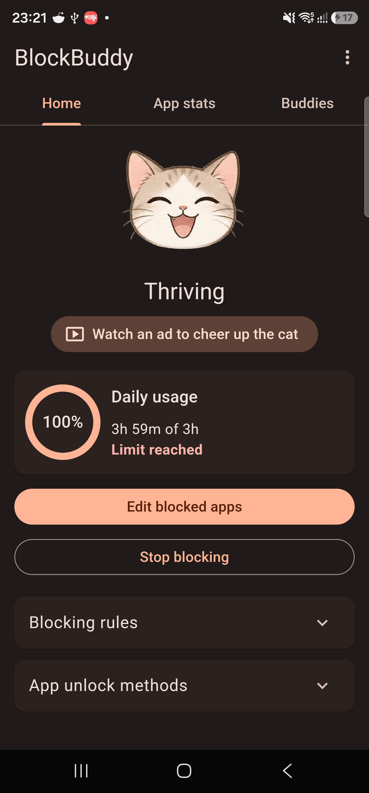
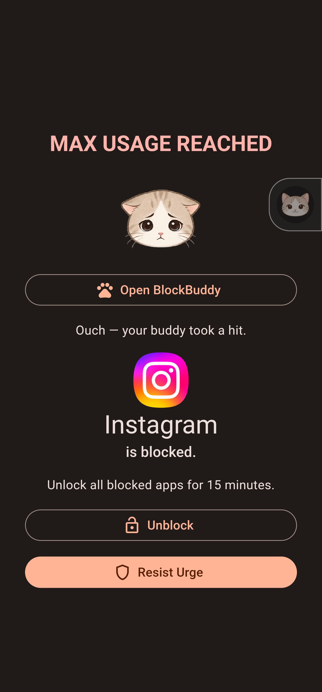
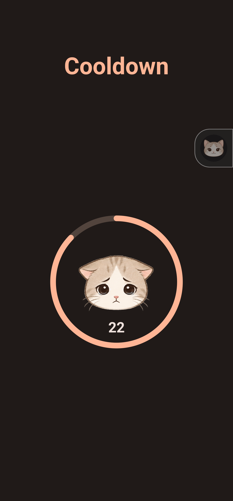

# BlockBuddy 🐾

**A kinder way to stop doom-scrolling.**

BlockBuddy blocks distracting Android apps and makes extra screen time something you earn—by walking, resisting the urge, or asking an accountability buddy.

  
  &nbsp;
  
  &nbsp;
  

 

**Version 1.0.0 · Android 13+**

## About this app

BlockBuddy turns app blocking into a small accountability system instead of a plain lock screen. A seven-state cat companion reacts to your choices, selected apps can be limited immediately, on a schedule, or by combined daily usage, and every successful unlock grants one shared 15-minute window.

## What you can do

- **Set meaningful limits** — immediate blocking, recurring schedules, and a combined daily allowance.
- **Walk to unlock** — complete a configurable step goal to earn 15 minutes.
- **Ask a buddy** — request approval from the cat or a paired friend.
- **Resist the urge** — leave the blocked app, celebrate with the cat, and enter a short cooldown.
- **Understand your habits** — review seven-day usage graphs for every selected app.
- **Stay accountable** — friends can receive activity and over-limit notifications and answer requests.

## Designed around the cat

The cat has seven health states, animated walking, damage feedback, custom audio, and a state-aware approval personality. Positive choices cheer it up; repeatedly opening blocked apps hurts its state.

## Privacy and permissions

BlockBuddy uses Android's Accessibility service to notice when a selected app opens and Android's system Usage Access history to calculate limits. It does not run a continuous usage-tracking service. Activity is shared only with a friend you explicitly pair with.

The complete production source, Firebase configuration, native interception implementation, signing material, and backend deployment code remain private. A few non-sensitive Flutter samples are available in [`samples/`](samples/) for portfolio review.

## Technical highlights

- Flutter UI with native Kotlin platform integration
- Android Accessibility, UsageStatsManager, step counter, exact alarms, and notification channels
- Firebase Authentication, Firestore, callable Functions, and Cloud Messaging
- Custom sprite rendering, animations, charts, rewarded ads, and background grant handling
- Feature-first architecture with analyzer, widget-test, Android-build, and lint verification

## Install

1. Tap **Download BlockBuddy APK** above.
2. Allow your browser to install apps from this source when Android asks.
3. Install the APK and follow BlockBuddy's guided permission setup.

The APK is signed with BlockBuddy's dedicated release certificate.

**SHA-256:** `7CD379CCBE40F6AD51CE6CD9591DB722284B3D6C2EB2C9C1962101B752BA19FC`

## Portfolio note

This repository is a curated product showcase, not the complete buildable source tree. Selected code is supplied for review only. **All rights reserved; no license to copy, redistribute, or create derivative works is granted.**
