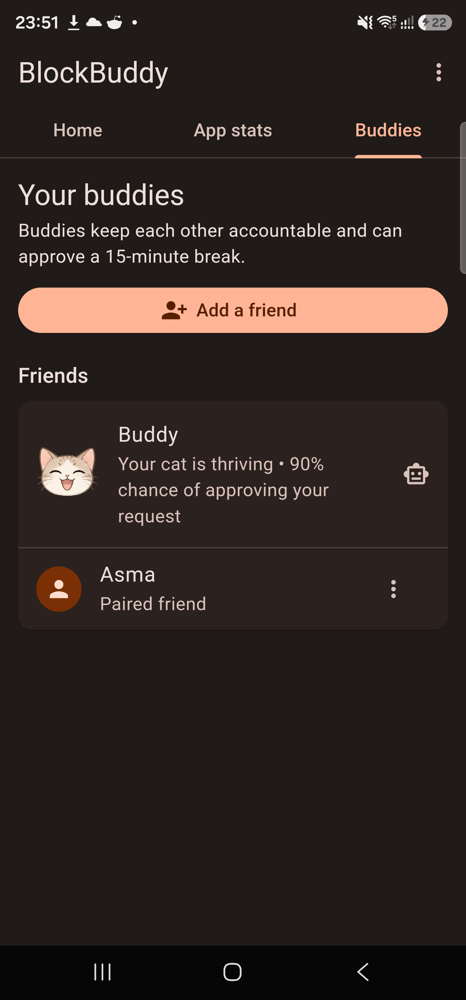

# BlockBuddy 🐾

**Stop doom-scrolling with limits that feel worth keeping.**

BlockBuddy blocks distracting Android apps, then makes those limits more effective through a cat you care for, healthier ways to earn extra time, and friends who help keep you accountable.

  
  &nbsp;
  
  &nbsp;
  

 

**Version 1.0.1 · Android 13+**

## Break the doom-scrolling loop

BlockBuddy helps interrupt compulsive app use with immediate blocking, recurring schedules, and a combined daily allowance. Instead of relying on a lock screen alone, it adds incentives and accountability that make your limits harder to dismiss.

When you reach a limit, you can resist the urge and help Buddy feel better, earn a short break by walking, or ask Buddy or a paired friend to approve 15 minutes of shared access. Every option is designed to replace an impulsive tap with an intentional decision.

## Why the limits are easier to keep

### Take care of Buddy

Buddy has seven emotional and health states that respond to your behavior. Resisting a blocked app rewards you with a happy reaction, while repeatedly pushing against your limits hurts the cat. Buddy can even act as your first accountability partner, with approval odds based on its current state.

### Stay on track with friends

Pair privately with a trusted friend to add human accountability. Friends can see your status, receive relevant limit alerts, and approve or deny a request for extra usage. Their answer is returned directly to you, turning the usual one-tap bypass into a deliberate decision shared with someone you trust.

## What you can do

- **Block distracting apps** — stop access immediately, on a recurring schedule, or after a combined daily allowance.
- **Care for your cat** — Buddy's state reflects how consistently you respect your limits.
- **Lean on a friend** — pair with someone you trust and ask them to approve extra time.
- **Resist the urge** — leave the blocked app, make Buddy happy, and reinforce the better choice.
- **Earn a short break** — complete a walking goal or receive buddy approval for a shared 15-minute window.
- **Understand your habits** — review seven-day usage graphs for every selected app.

## Privacy and permissions

BlockBuddy uses Android's Accessibility service to notice when a selected app opens and Android's system Usage Access history to calculate limits. It does not run a continuous usage-tracking service. Accountability activity is shared only with a friend you explicitly pair with.

The complete production source, Firebase configuration, native interception implementation, signing material, and backend deployment code remain private. A few non-sensitive Flutter samples are available in [`samples/`](samples/) for portfolio review.

## Technical highlights

- Flutter UI with native Kotlin platform integration
- Android Accessibility, UsageStatsManager, step counter, exact alarms, and notification channels
- Firebase Authentication, Firestore, callable Functions, and Cloud Messaging
- Custom sprite rendering, animations, charts, rewarded ads, and background grant handling
- Feature-first architecture with analyzer, widget-test, Android-build, and lint verification

## Install

1. Tap **Download BlockBuddy APK** above.
2. Allow your browser to install apps from this source when Android asks.
3. Install the APK and follow BlockBuddy's guided permission setup.

The APK is signed with BlockBuddy's dedicated release certificate.

**SHA-256:** `83271E7BB6821F3B55938E32528601F68D23E0FC3D5BD52BDBB5FEBC9EA1E968`

## Portfolio note

This repository is a curated product showcase, not the complete buildable source tree. Selected code is supplied for review only. **All rights reserved; no license to copy, redistribute, or create derivative works is granted.**
